# Architecture Overview

This document describes the high-level architecture of `mimick`, a Linux desktop daemon and client for syncing media to Immich.

## System Components

The application is a **single-process** Rust daemon using the GTK4/Tokio runtime with application ID `dev.nicx.mimick`.

```mermaid
graph TD
    User[User] -->|Clicks Library| Tray[System Tray Icon - ksni]
    Tray -->|tokio::sync::watch channel| Main[GTK Main Loop - main.rs]

    subgraph Daemon [Primary Process]
        Main --> Monitor[File Monitor - notify crate]
        Main --> QueueManager[Queue Manager]
        Main --> SharedState["Arc<Mutex<AppState>> - in memory"]
        Main --> RuntimeEnv[Runtime Environment Checks]
        Main --> StartupScan[Startup Catch-Up Scan]
        Main --> RemoteSync[Remote Album Reconciler - 5 min loop]

        Monitor -->|File Events + SHA-1| QueueManager
        StartupScan -->|Unsynced files| QueueManager
        RemoteSync -->|Diff & re-queue| QueueManager
        QueueManager -->|1-10 async workers| API[Immich API Client - shared]
        QueueManager -->|Update directly| SharedState
        QueueManager -->|Pause policy checks| RuntimeEnv

        API -->|LAN / WAN failover| Immich[(Immich Server)]
    end

    subgraph Library UI [GTK4 / Libadwaita]
        Window[Library / Settings Window] -->|500ms timer| SharedState
        Window -->|Diagnostics export| Diagnostics[diagnostics.rs]
        Window -->|Fetch / Bidirectional Sync| API
        Window -->|Server thumbnails + ThumbHash placeholder| ThumbCache[Thumbnail Cache - LRU + disk]
        Window --> LocalSource[Local Source Enumeration]
        Window --> LocalExif[Local EXIF Parser]
        Window --> Lightbox[Lightbox + Multi-format Decoders]
        Lightbox -->|libraw, libheif-rs, jxl-oxide, resvg, psd, turbojpeg| ThumbCache
        Lightbox -->|In-app playback: GstPlay + gtk4paintablesink| VideoPlayer[Video Player]
        Lightbox -->|Open with: spawn_video_handoff| ExternalPlayer[Chosen External App]
        LocalSource -->|Synthetic asset rows| Window
        LocalExif -->|Cached EXIF| Window
    end

    Main -->|present / set_visible| Window

    subgraph Storage
        Config["config.json (~/.config/mimick/)"]
        Keyring[Keyring - oo7 via Secure Portal / D-Bus]
        RetryFile["retries.json (~/.cache/mimick/) - written on shutdown only"]
        StateFile["status.json (~/.cache/mimick/) - written on shutdown only"]
        ThumbStore["thumbnails/ (~/.cache/mimick/thumbnails/)"]
        RawCache["raw_decode/ (~/.cache/mimick/raw_decode/)"]
        ExifCache["exif/ (~/.cache/mimick/exif/)"]
        VideoCache["video/ (~/.cache/mimick/video/) - Open with handoff"]
        SyncIndex["synced_index.json (~/.local/share/mimick/)"]
    end

    Window -->|Read/Write| Config
    Window -->|Read/Write| Keyring
    Main -->|Read on startup, Write on exit| StateFile
    QueueManager -->|Write on exit| RetryFile
    Main -->|Read/Write| SyncIndex
    ThumbCache -->|LRU / Write| ThumbStore
    Lightbox -->|Demosaic cache write| RawCache
    LocalExif -->|Write| ExifCache
    Lightbox -->|Remote video download| VideoCache
    Diagnostics -->|Copy selected files| Storage
```

## Component Details

### 1. Core Daemon (`src/main.rs`)

Initializes the GTK4 `adw::Application` with ID `dev.nicx.mimick`. Only the primary instance (determined via D-Bus single-instance enforcement) spawns daemon services. Secondary processes forward their command line to the primary via GTK's single-instance mechanism.

- `connect_command_line` opens the library window when `--settings` or `--library` is passed **or** when `cmdline.is_remote()` is true (user clicks the app icon while the daemon is already running)
- Shared `Arc<Mutex<AppState>>` is created before all closures and threaded into both `connect_startup` (workers) and `connect_command_line` (library window)
- Shared `AppContext` is stored in a `OnceLock` and reused by UI windows and shutdown paths (single API client, queue manager, monitor handle)

### 2. File Monitor (`src/monitor.rs`)

Uses the `notify` crate for inotify-based filesystem events. Inside Flatpak, falls back to a polling watcher so portal-backed directories continue to sync reliably.

- Filters to media extensions only
- Applies per-folder rules before queueing files
- Ignores temporary files until the final media filename exists
- 2-second debounce per path
- Per-file `wait_for_file_completion` (async, Tokio task -- no OS thread per file)
- SHA-1 checksum via 64KB chunked `spawn_blocking` (no load into RAM)
- Supports live watch-path replacement via `MonitorHandle` without restarting the daemon

### 3. Queue Manager (`src/queue_manager.rs`)

Thread-safe upload orchestrator using a single `Arc<Mutex<AppState>>` for all counters and status.

- **Configurable async workers** (1-10, default 3) sharing one `mpsc::Receiver` via `Arc<tokio::sync::Mutex>`
- Workers update `AppState` directly in memory -- no disk writes during uploads
- **In-memory retry list** (`Arc<std::sync::Mutex<Vec<FileTask>>>`): retries on next successful upload (network recovery), flushed to disk only on graceful shutdown via `QueueManager::flush_retries()`
- Reads persisted retries from disk on startup (crash recovery); re-queues after 5s delay
- Supports manual `Pause / Resume`, `Sync Now`, queue inspection, per-item retry, retry-all, and failed-queue clearing
- Records recent queue events and pause reasons in shared state for UI visibility and diagnostics
- The `QueueManager` lives in `AppContext`; shutdown calls `flush_retries()` from the shared handle after `app.run()` returns
- Environment-aware pause policy: metered network, battery power, and quiet-hours window deferral

### 4. API Client (`src/api_client.rs`)

- LAN-first, WAN fallback connectivity check
- Active URL cached in `Mutex<Option<String>>`; cleared on network error to force re-check
- Files streamed with `reqwest::multipart::Part::stream_with_length` -- zero RAM buffering
- Full 40-char SHA-1 hex used as `device_asset_id` for reliable Immich server-side deduplication
- Connection pool: up to 24 idle connections per host (one per download slot below), 90s idle timeout, so thumbnail bursts reuse connections
- Image downloads use two permit pools: 16 for grid thumbnails and 8 for previews and originals, so the lightbox never waits behind the grid
- Explore places come from `GET /api/search/cities` (one asset per city), falling back to paging `/api/search/metadata` when that fails
- Single shared instance via `AppContext` -- no new reqwest pool per window open
- Structured error diagnostics with actionable guidance for common failure modes
- Extended endpoints for library integration (Explore, Albums, Search, Smart Search, OCR)

### 5. Library View & Settings UI (`src/settings_window/`, `src/library/`)

- The main user interface is a unified `adw::PreferencesWindow` that doubles as the Library View and the Settings panel.
- Built on demand from `AppContext`; close destroys the window (unless background sync is disabled, in which case the app quits)
- Includes distinct library pages: **Photos**, **Explore**, **Albums**, and **Search**.
- Supports manual uploads via the `upload_picker` module, directly enqueueing multi-file selections.
- The main menu's **Keyboard Shortcuts** item (`win.shortcuts`, **Ctrl+?**) opens an `AdwShortcutsDialog` built from the static table in `shortcuts_dialog.rs`; a unit test checks every listed key name parses.
- `Arc<Mutex<AppState>>` accessed from `AppContext`; the 500ms `glib::timeout_add_local` timer reads it without any disk I/O to drive the footer Sync Status indicator.
- Test Connection button uses the shared client -- no new reqwest pool per click
- Saving applies updated API settings, queue policy, worker limit, and watched folders to the running process without a restart

### 6. Thumbnail Cache (`src/library/thumbnail_cache.rs`)

Provides fast, responsive image previews for the Library View.

- Uses `ThumbHash` and Base64 encoded payload storage for extremely small footprints.
- Two-tier caching mechanism:
  - **Memory Cache**: `lru::LruCache` for instantaneous rendering while browsing.
  - **Disk Cache**: Persisted to `~/.cache/mimick/thumbnails/` to survive application restarts.
- The memory cache is cleared when the library window closes; 3s later `malloc_trim(0)` hands the freed memory back to the system, since glibc otherwise keeps it in per-thread arenas.

### 7. Local Source & Album Sync (`src/library/local_source.rs`, `src/library/album_sync.rs`)

Supports bidirectional synchronization directly from the Albums page.

- **Local Source**: Enumerates files in configured watch folders and generates synthetic standard assets identical in shape to remote assets.
- **Album Sync**: Compares SHA-1 hashes of local source items against remote album assets to identify missing items in either direction (uploads vs downloads).
- Collision avoidance using numeric suffixes (e.g., `file (1).jpg`) when downloading.

### 8. System Tray (`src/tray_icon.rs`)

- Uses `ksni` (D-Bus StatusNotifierItem)
- Clicking tray actions sends signals back to the GTK main loop -- **no child process spawned**
- The Tokio watch-forward task sets an `Arc<Mutex<bool>>` flag and wakes a `tokio::sync::Notify`; a `spawn_local` future on the GTK main loop awaits it and handles the request in-process (no polling timer)

### 9. Runtime Environment (`src/runtime_env.rs`)

Best-effort helpers used by queue policy:

- `nmcli` parsing to detect metered or guessed-metered connections
- `/sys/class/power_supply` inspection to detect battery-powered operation

These checks are advisory and only affect uploads when the corresponding behavior switches are enabled.

### 10. Startup Scan (`src/startup_scan.rs`)

Walks all configured watch folders on launch and queues media files that are not yet recorded in the sync index.

- Respects the user's configured startup catch-up mode (`Full`, `RecentOnly`, `NewFilesOnly`)
- Applies the same per-folder rules and media-extension filter used by the live monitor
- Detects album-target changes and queues reassociation-only tasks for unchanged files that have moved albums
- Also used by the manual `Sync Now` action from the tray and Library View footer

### 11. Sync Index (`src/sync_index.rs`)

Maintains a persistent map of previously synced files at `~/.local/share/mimick/synced_index.json` (moved from the cache directory to survive user cache clears).

- Keyed by file path, stores SHA-1 checksum, album name, and album ID
- Used during startup scans to skip unchanged files and avoid redundant uploads
- Detects when a file's content has changed (checksum mismatch) and re-queues it
- Detects album-target changes and triggers reassociation without re-uploading the file data
- Written as compact JSON only when something changed: every 10s on the blocking pool, and when the upload queue goes idle (after the shared state lock is released)

### 12. Notifications (`src/notifications.rs`)

Provides desktop notification helpers using `gio::Notification` and the XDG notification portal.

- Global enable/disable toggle controlled by the user-facing "Enable Notifications" switch
- Batch sync-complete summary notification (fired once when the queue drains, not per file)
- Connectivity-lost notification (fired once per session after consecutive upload failures)
- All dispatches route through `glib::idle_add_once` to stay on the GTK main thread

### 13. Diagnostics (`src/diagnostics.rs`)

Exports a redacted support bundle for troubleshooting.

- Writes `summary.txt`, `privacy-note.txt`, `config.redacted.json`, `status.redacted.json`, `retries.redacted.json`, and `synced_index.redacted.json`
- All local paths are redacted to filename-only hints
- API keys, raw logs, server URLs, and full local paths are intentionally omitted

### 14. Autostart (`src/autostart.rs`)

Handles autostart integration for both native and Flatpak contexts.

- Inside Flatpak: requests background permission via the `ashpd` Background portal
- Outside Flatpak: writes a standard autostart desktop entry to `~/.config/autostart/dev.nicx.mimick.desktop`
- Disabling autostart removes the entry (or revokes the portal request)

### 15. Watch Path Display (`src/watch_path_display.rs`)

Utility module for displaying user-friendly labels for watch paths, especially portal-backed Flatpak folders.

- Detects document-portal paths (`/run/user/.../doc/...`) and shows the folder name instead
- Provides subtitle hints for portal-selected folders in the UI

### 16. Remote Album Reconciler (`src/remote_sync.rs`)

Periodic background task that re-runs the per-folder album↔folder diff on a fixed interval (5 min) so changes made directly in Immich (asset additions, deletions, album moves) propagate to local folders without requiring an app restart.

- Skips silently when background sync is disabled, when the queue is paused, or when the API connectivity check fails
- Delegates the actual diff to `startup_scan::reconcile_entry`, so the catch-up code path is shared between launch and steady-state reconciliation
- Runs alongside the live file monitor; the monitor handles fresh local edits while this loop handles remote-side and missed events

### 17. Lightbox + Decoders (`src/library/lightbox.rs`, `src/library/lightbox/`, `src/library/video_player/`, `src/library/mod.rs`)

Full-screen viewer with its own multi-format decoder pipeline, independent of the grid thumbnail cache.

- Decoder routing by extension (see `texture_decoder_for_path`): RAW via libraw + imagepipe fallback, HEIF/AVIF via libheif-rs, JXL via jxl-oxide, SVG via resvg, PSD via the pure-Rust `psd` crate, JPEG via turbojpeg, then pixbuf, then the `image` crate as final fallback
- RAW decoding uses LibRaw 0.21.3, compiled from source by the `rsraw-sys` crate (bindings generated with bindgen, so builds need libclang)
- RAW fast path extracts the embedded camera JPEG preview, picking the largest SOI-bounded payload in the file (resolves tiny previews on Samsung DNG and similar). The scan still runs when LibRaw can't open the file (e.g. a camera newer than LibRaw), relying on the preview's own EXIF orientation. LibRaw's fallback bitmap thumbnails are accepted at 8 or 16 bits per sample
- The full demosaic path is gated behind the "Full RAW Decoding" setting; grid thumbnails that have no embedded preview use a half-size demosaic instead
- Full demosaics are cached in `~/.cache/mimick/raw_decode/` under a blake3 key of path, mtime and size; entries are written to a temporary file and renamed into place, so readers never see a partial PNG
- Videos take a poster path: the still thumbnail is shown with a play badge that starts in-app playback. `lightbox/video.rs` creates the player lazily on the first video and drops it when the lightbox closes. `video_player.rs` holds playback state; its submodules build the control bar (`controls.rs`), the GStreamer pipeline (`pipeline.rs`), and the audio/subtitle menu (`tracks.rs`). Player events arrive as GstPlay bus messages on a main-thread watch, since GstPlay's signal adapter needs `Send` callbacks. The player wraps GstPlay with `gtk4paintablesink` (inside `glsinkbin` when GTK has a GL context), so VA-API decoders are picked automatically when available. Remote videos stream from `/api/assets/{id}/video/playback` with the API key sent as an `x-api-key` header from playbin's `source-setup` signal; local files play from disk
- **Open with…** uses `gtk::FileLauncher` with always-ask (`open_with_chooser`); remote videos are first downloaded to `~/.cache/mimick/video/` by `spawn_video_handoff`
- Fullscreen (`lightbox/fullscreen.rs`) follows the window's `fullscreened` state: it hides the action bar and details pane, removes the viewer margins, switches the picture background to black, and lets the header overlay the content (`extend-content-to-top-edge`) so it can slide in on pointer motion or tap and auto-hide after 3 seconds
- Assets with `isEdited` load Immich's edited render: previews via `/thumbnail?size=preview&edited=true`, cached under `preview-edited:{id}`, and originals via `/original?edited=true`, cached as `{id}-edited.bin` so the decoder sniffs the format. A matching local file is used only when the edited render can't be fetched; unedited assets keep their existing URLs and cache keys
- Recognized text (`lightbox/ocr.rs`) fetches `/api/assets/{id}/ocr` once the picture loads (dropped if the user has moved on) and draws the boxes on a non-interactive `DrawingArea` overlaid on the picture stack inside the scroller, so it pans and zooms with the photo. Box corners are normalized to the edited image and mapped into the picture's contain-fit rect; boxes are grouped into rows and sorted into reading order. Input is handled on the scroller: a capture-phase drag gesture claims mouse presses on a box for selection, while touch taps toggle boxes and touch drags keep panning
- EXIF details fetched via the API for remote assets or via `local_exif` for local files (skipped entirely for videos)
- Maps (`src/library/map/`) use libshumate. `tiles.rs` loads the chosen style (`styles.rs`: the server's URLs from `/api/server/config`, a VersaTiles palette, or OpenStreetMap; saved as `library_map_style`) once and gives every map its light or dark source to match `AdwStyleManager`, falling back to OpenStreetMap raster tiles. The three most recently used styles stay loaded, so switching back is instant; a style's light and dark variants, and each one's TileJSON and sprite sheet, download in parallel. `style.rs` prepares the MapLibre style for libshumate's vector renderer: TileJSON links are fetched and embedded, `is-supported-script` becomes `true`, any layer libshumate still rejects is dropped, and the sprite sheet is loaded separately. Tiles are cached by libshumate under a per-style id
- The Map page (`map/view.rs`) loads `/api/map/markers` and clusters them at the current integer zoom (`map/cluster.rs`): markers are binned into 60 px Web Mercator cells, and the fullest bins absorb neighbouring bins whose centres are within 60 px. Clustering runs on a blocking worker thread; the levels just above and below the current one are computed ahead, five levels stay cached, and results for markers that have since reloaded are dropped. Until a new level is ready the previous markers stay on screen. Only clusters within the (rotated) viewport plus the radius are added to the marker layer, refreshed at most every 120 ms while the map moves, and only the difference is added or removed; single photos are keyed by marker rather than zoom level, so their widgets and thumbnails survive zooming. Thumbnails load through the thumbnail cache and are cancelled once their marker is gone; tooltips work out the place only on hover. Size changes come from an overlaid `DrawingArea`'s `resize` signal
- libshumate repeats the world vertically once it is shorter than the map, so `map/camera.rs` raises the zoom and clamps the centre latitude on every viewport change to keep the map's (rotated) height inside one world
- `map/layout.rs` puts the map and the content stack in a `GtkPaned`: the map alone for `LibraryPage::Map`, and beside the grid (vertical under 600 px) for `LibrarySource::MapArea`, which pages through the chosen asset IDs 32 at a time with `GET /api/assets/{id}`, 16 requests in parallel. The grid, lightbox, selection, and bulk bar are the normal ones. Switching between map areas replaces the history entry, and the sidebar is hidden while the list is open and restored after
- **Show my location** (`map/locate.rs`) uses the XDG Location portal through ashpd (street accuracy, 20 s timeout), so the Flatpak needs no extra permission
- **Set Location** (`map/location_dialog.rs`) searches `/api/search/places` and saves with one `PUT /api/assets` for all chosen IDs. The details-pane mini map (`map/minimap.rs`) is a non-interactive map inside a button that opens the Map page there; one instance per window is moved between photos, so its tiles stay drawn

### 18. State & Persistence

- **`AppState`**: in-memory struct shared by workers and UI via `Arc<Mutex<AppState>>`; includes pause state, pause reason, last completed file, diagnostics export count, and recent queue events
- **`StateManager`** (`src/state_manager.rs`): reads saved state on startup for crash recovery; writes on graceful shutdown only
- **Retry queue**: in-memory during session; disk path `~/.cache/mimick/retries.json` written only on exit
- **Sync index**: persisted at `~/.local/share/mimick/synced_index.json` to skip unchanged files across restarts and to detect album-target changes
- **Thumbnail cache**: `~/.cache/mimick/thumbnails/` for fast preview rendering
- **RAW Decode cache**: `~/.cache/mimick/raw_decode/` for persisting full sensor demosaics
- **Local EXIF cache**: `~/.cache/mimick/exif/` for persisting local metadata reads
- **Notifications**: natively handled via `gio::Notification` and the XDG notification portal; ensures safe delivery without `notify-send` sub-processes when sandboxed
- **Keyring**: API keys are securely persisted through the `oo7` crate -- natively talking D-Bus Secret Service, or reading an encrypted sandbox file when running across the Flatpak boundary
