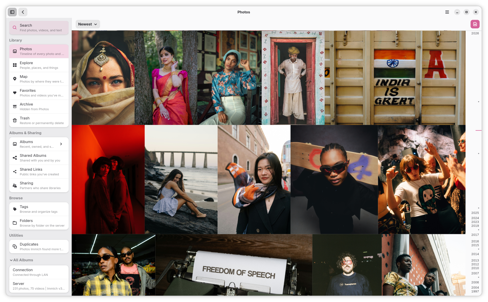

# Mimick Wiki

Welcome to the Mimick project wiki.

Mimick is a Linux background app that watches selected folders and syncs photos and videos to an Immich server. It supports native Linux installs and Flatpak, uses a GTK4/Libadwaita settings window, and keeps syncing reliable with retries, startup catch-up scans, and duplicate-aware uploads.

  

  

## Start Here

## Developers and Contributors

## Project Notes

- By default a watch folder only uploads to Immich and never changes local files. Its **Sync Method** can also be **Download Only** or **Full Sync**, which download its album's photos into the folder. See [Sync Behavior](Sync-Behavior).
- API keys are stored in the desktop keyring. Logs and the retry queue live in `~/.cache/mimick/`, and the sync index in `~/.local/share/mimick/`.
- Startup rescans use the sync index, so unchanged files that are already synced are skipped quickly.

## Current App Highlights

- Two-page `Settings` / `Status` settings window
- Upload each watched folder to the Immich library, an album you pick, or an album named after the folder
- Per-folder sync methods (Upload Only, Download Only, Full) with optional deletion mirroring in either direction
- In-app library viewer, on by default: a Photos timeline with date headings, a scrubber, Memories, and stacks, albums and other collections that scroll like it, Large Files with sizes and filters, Missing Location with dates and nearby places, and Unusual Dates, albums, Explore with a photo calendar, search that picks several people, tags, and albums and lists the cameras and places in your library, People, Tags, Folders you can expand in place or jump to by path, Favorites, Archive, Trash, and Duplicates
- In-app video playback (streamed from Immich, hardware-decoded), live photos, 360° photos you can look around in, slideshows, and fullscreen viewing in the lightbox
- Select and copy text Immich recognized in photos (OCR), down to a word or a few characters, and tag the people in a photo and see who is who by pointing at their faces, in the lightbox
- Edit photos without touching the original: crop, rotate, flip, and straighten, adjust light and colour, apply filters, and redact faces or number plates, find similar photos, and jump from any view to a photo's place in the timeline
- Map of your photos with place search and settings for favorites, archived, partners', and shared albums' photos and date ranges, a map of any album, a location mini map in the lightbox, and setting the location of one or many photos with the place named
- Shared albums with Viewer and Editor roles, likes and comments, public shared links with QR codes and photos you can add or take out, and partner sharing, including browsing a partner's photos
- Album management: add photos to one or several albums at once, remove photos, set covers, album options, delete albums, leave shared albums, download albums as zip, album counts, and see which albums a photo is in
- Your Immich account: profile picture with cropping, signed-in devices, API keys with Rotate, and a notifications inbox that also reaches the desktop
- Edit asset info (description, date taken, favorite), favorite, describe, refresh, or change the date and time zone of many photos at once (**Ctrl+A** selects the whole view), rate assets with stars, archive, and move assets to the Immich trash from the library
- RAW previews and decoding, and every media format Immich supports
- Drag files in to upload, drag photos out to export, and **Open With Mimick** from your file manager
- Works on Linux phones, down to 360 px wide, with a bottom navigation bar
- Keyboard Shortcuts dialog (**Ctrl+?** or the main menu)
- Queue inspector with retry actions
- Per-folder rules for hidden paths, size limits, and extension filters
- Diagnostics bundle export for support and bug reports, with detailed logs on demand and the log's private details removed
- Follow System, Light, or Dark style with light palettes (Warm White, Lavender, Mint) and dark ones (Black, Midnight, Mocha), and an About dialog with what's new and debug info
- Quiet hours, and metered-network and battery-aware upload deferral
